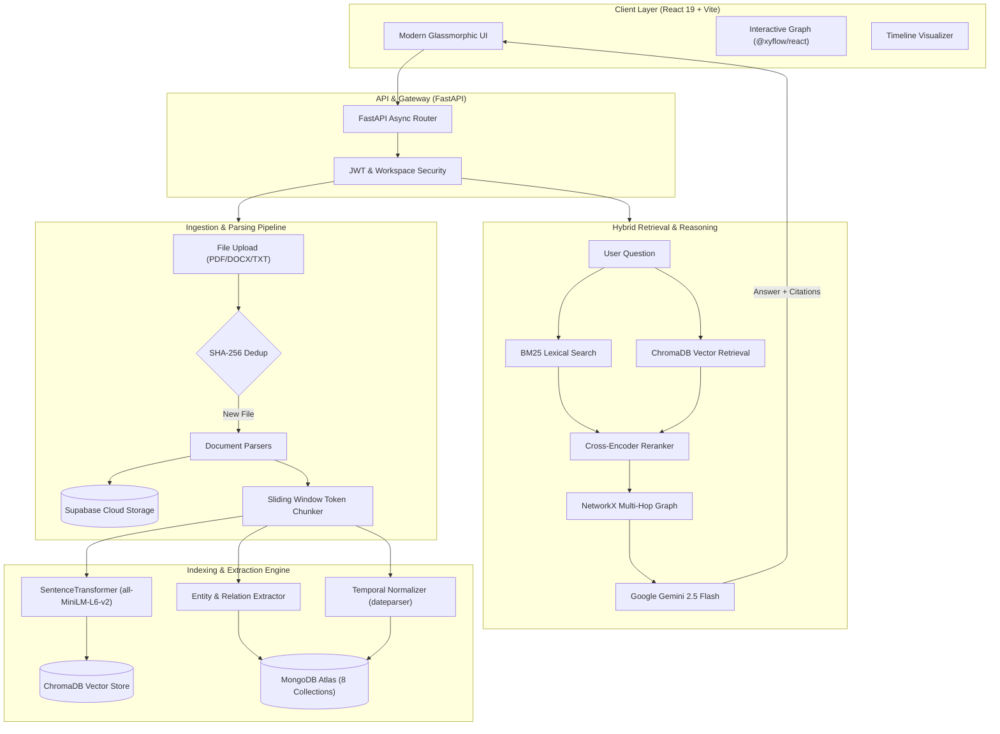

<div align="center">

# 🌌 Echoes Search
### *Personal Knowledge Reconstruction & Multi-Hop Hybrid RAG Engine*

[](https://www.python.org/)
[](https://fastapi.tiangolo.com/)
[](https://react.dev/)
[](https://www.typescriptlang.org/)
[](https://www.mongodb.com/atlas)
[](https://supabase.com/)
[](https://www.trychroma.com/)
[](https://ai.google.dev/)

<p align="center">
  <b>Echoes Search</b> transforms scattered documents, research notes, contracts, and archives into an interconnected <b>Knowledge Graph</b>, <b>Chronological Timeline</b>, and <b>Evidence-Backed Q&A System</b>.
</p>

[Key Features](#-key-features) • [Architecture](#-system-architecture) • [Tech Stack](#-tech-stack) • [Quick Start](#-getting-started) • [Environment Variables](#-environment-variables) • [API Reference](#-api-endpoints)

---

</div>

## 🌟 Overview

Traditional search systems locate files using simple keywords, while standard RAG systems frequently miss cross-document relationships and temporal evolution. **Echoes Search** bridges this gap by unifying:

1. **Dense Vector Embeddings** (ChromaDB + SentenceTransformers) for semantic context.
2. **Lexical Keyword Matching** (BM25) for exact phrases, names, and code identifiers.
3. **Knowledge Graph Traversal** (NetworkX) for exploring multi-hop entity relationships.
4. **Chronological Event Ordering** (Temporal Normalization) for understanding historical evolution.
5. **Generative Synthesis with Verifiable Citations** (Google Gemini 2.5 Flash) ensuring every claim links directly back to original document excerpts.

---

## ⚡ Key Features

- 📑 **Smart Multi-Format Ingestion**
  - Native parsing for **PDF** (`PyMuPDF`), **DOCX** (`python-docx`), **Markdown**, and **Plain Text**.
  - Automatic cryptographic SHA-256 deduplication to prevent duplicate file processing.
  - Configurable chunking (default 512 tokens with 64-token overlap) preserving paragraph structure.

- ☁️ **Dual Cloud & Local Storage Architecture**
  - **Supabase Cloud Storage**: Secure, scalable object storage with signed expirable URLs for original source files.
  - **MongoDB Atlas**: Primary source of truth with 8 collections and 35 indexes enforcing multi-tenancy and workspace boundaries.
  - **ChromaDB**: Fast local vector store indexing dense embeddings.

- 🔎 **Hybrid Retrieval with Reciprocal Rank Fusion & Reranking**
  - Evaluates both semantic vectors and lexical BM25 scores simultaneously.
  - Cross-encoder reranking produces high-precision candidate chunks.

- 🕸️ **Interactive Knowledge Graph & Timeline**
  - Automatically identifies **People**, **Organizations**, **Projects**, and **Concepts**.
  - Extracts relationships (e.g., *Rahul MANAGED Project Apollo*) with contextual evidence.
  - Visualized via interactive multi-ring concentric layouts powered by **React Flow** (`@xyflow/react`).
  - Interactive chronological timeline reconstructing sequential history.

- 🤖 **Reasoning with Strict Grounded Citations**
  - Google Gemini 2.5 Flash synthesizes answers strictly grounded in retrieved evidence.
  - Every answer includes clickable source badges referencing document name, page, and chunk excerpt.

- 🛡️ **Production-Ready Security & Multi-Tenancy**
  - JWT token-based authentication with password hashing (bcrypt).
  - Built-in support for Google OAuth & Firebase.
  - Strict workspace-level data isolation preventing cross-tenant leakage.

---

## 🏗️ System Architecture



---

## 💻Tech Stack

| Domain | Technology | Purpose |
|---|---|---|
| **Backend Framework** | **FastAPI** (Python 3.10+) | Asynchronous, high-throughput REST API with automatic OpenAPI documentation. |
| **Async DB Driver** | **Motor + PyMongo** | Non-blocking MongoDB communication for high concurrency. |
| **Primary Database** | **MongoDB Atlas** (`echoes_db`) | Houses 8 indexed collections: `users`, `workspaces`, `documents`, `chunks`, `entities`, `events`, `relationships`, `queries`. |
| **Vector Database** | **ChromaDB** | High-dimensional dense vector embeddings storage and k-NN retrieval. |
| **Cloud File Storage** | **Supabase Storage** | Resilient object storage for uploaded PDF/DOCX files with expirable signed download URLs. |
| **Embeddings** | **SentenceTransformers** (`all-MiniLM-L6-v2`) | Compact, highly performant 384-dimensional dense semantic embeddings. |
| **Keyword Search** | **rank-bm25** | Exact-token lexical scoring complementing semantic search. |
| **LLM & Reasoning** | **Google Gemini 2.5 Flash** | Context synthesis, entity extraction, and evidence-grounded generation. |
| **Graph Processing** | **NetworkX** | In-memory graph data structure for multi-hop entity traversal and neighborhood analysis. |
| **Frontend Framework** | **React 19 + TypeScript + Vite** | Lightning-fast client with modern hooks, type safety, and instant HMR. |
| **Styling & Icons** | **Tailwind CSS + Lucide Icons** | Dark glassmorphic design system with modern micro-animations. |
| **Graph Visualization**| **@xyflow/react** (React Flow) | Hardware-accelerated canvas for knowledge graph nodes and interactive edges. |

---

## 📁 Repository Structure

```text
Echoes/
├── backend/
│   ├── app/
│   │   ├── api/
│   │   │   ├── routes/
│   │   │   │   ├── auth.py          # User registration, login, JWT verification
│   │   │   │   ├── documents.py     # Upload, ingestion, deletion, download
│   │   │   │   ├── graph.py         # Knowledge graph nodes, edges, exploration
│   │   │   │   ├── health.py        # Healthcheck and status diagnostics
│   │   │   │   ├── query.py         # Gemini RAG Q&A with citations
│   │   │   │   └── search.py        # Hybrid search (semantic + BM25)
│   │   ├── core/
│   │   │   ├── config.py            # Pydantic BaseSettings environment manager
│   │   │   └── security.py          # Password hashing and JWT generation
│   │   ├── models/                  # 8 Pydantic V2 Domain Models
│   │   │   ├── chunk.py
│   │   │   ├── document.py
│   │   │   ├── entity.py
│   │   │   ├── event.py
│   │   │   ├── query.py
│   │   │   ├── relationship.py
│   │   │   ├── user.py
│   │   │   └── workspace.py
│   │   ├── services/
│   │   │   ├── auth.py              # User authentication logic
│   │   │   ├── database.py          # Motor async & PyMongo clients + SSL fix
│   │   │   ├── ingestion.py         # Document processing coordinator
│   │   │   ├── supabase_storage.py  # Supabase Storage client
│   │   │   ├── graph/               # Entity & relationship extractors
│   │   │   ├── llm/                 # Gemini API integration
│   │   │   ├── parsers/             # PDF, DOCX, TXT parsers
│   │   │   └── retrieval/           # Hybrid search & cross-encoder rerankers
│   │   └── main.py                  # FastAPI lifespan entrypoint
├── frontend/
│   ├── src/
│   │   ├── components/              # Layout, Sidebar, Navbar, StatCards, Modals
│   │   ├── pages/
│   │   │   ├── DashboardPage.tsx    # Live workspace metrics & recent activity
│   │   │   ├── DocumentsPage.tsx    # Document upload & management
│   │   │   ├── GraphPage.tsx        # Interactive knowledge graph visualizer
│   │   │   ├── SearchPage.tsx       # Hybrid search & conversational Q&A
│   │   │   ├── TimelinePage.tsx     # Chronological event reconstruction
│   │   │   └── LoginPage.tsx        # Authentication page
│   │   ├── services/
│   │   │   └── api.ts               # Axios client with JWT interceptors
│   │   ├── App.tsx                  # React Router configuration
│   │   └── main.tsx                 # DOM root mount
├── scripts/
│   └── init_db.py                   # Automated MongoDB Atlas collection & index builder
├── storage/
│   ├── documents/                   # Local file backup directory (.gitkeep)
│   └── vectors/                     # ChromaDB SQLite & segment files (.gitkeep)
├── tests/                           # 41+ passing automated pytest suite
├── .env.example                     # Backend environment template
├── requirements.txt                 # Backend Python dependencies
└── README.md
```

---

## 🚀 Getting Started

### Prerequisites

Ensure you have installed:
- **Python 3.10+** (Tested on Python 3.11, 3.12, 3.13)
- **Node.js 18+** & **npm**
- **Git**
- Accounts & API keys for:
  - [MongoDB Atlas](https://www.mongodb.com/atlas) (Free M0 cluster is sufficient)
  - [Google AI Studio](https://aistudio.google.com/) (Gemini API Key)
  - [Supabase](https://supabase.com/) (Free project for Storage bucket)

---

### Step 1: Clone the Repository

```bash
git clone https://github.com/Nitinkumar1412/Echoes.git
cd Echoes
```

---

### Step 2: Backend Setup

1. **Create and activate a virtual environment**:
   ```bash
   # Windows (PowerShell)
   python -m venv .venv
   .\.venv\Scripts\Activate.ps1

   # Linux / macOS
   python3 -m venv .venv
   source .venv/bin/activate
   ```

2. **Install Python dependencies**:
   ```bash
   pip install --upgrade pip
   pip install -r requirements.txt
   ```

3. **Configure Environment Variables**:
   Copy `.env.example` to `.env` in the root folder:
   ```bash
   cp .env.example .env
   ```
   Open `.env` and fill in your actual credentials:
   ```ini
   # MongoDB Atlas Connection String
   MONGODB_URI="mongodb+srv://<username>:<password>@<cluster>.mongodb.net/?retryWrites=true&w=majority"
   MONGODB_DATABASE="echoes_db"

   # Google Gemini API Key
   GEMINI_API_KEY="AIzaSy..."
   MODEL_NAME="gemini-2.5-flash"

   # Supabase Storage Configuration
   SUPABASE_URL="https://<your-project-ref>.supabase.co"
   SUPABASE_KEY="<your-supabase-service-role-secret-key>"
   SUPABASE_BUCKET="Echoes_documents"

   # Security
   JWT_SECRET_KEY="generate-a-long-random-secret-key"
   ```

4. **Initialize Database Collections & Indexes**:
   Run the initialization script to automatically create all 8 collections and 35 indexes in MongoDB Atlas:
   ```bash
   python scripts/init_db.py
   ```

5. **Start the FastAPI Backend**:
   ```bash
   uvicorn backend.app.main:app --reload --host 127.0.0.1 --port 8000
   ```
   *Your API will now be live at `http://127.0.0.1:8000`. You can access interactive Swagger docs at `http://127.0.0.1:8000/docs`.*

---

### Step 3: Frontend Setup

1. **Navigate to the frontend folder**:
   ```bash
   cd frontend
   ```

2. **Install Node packages**:
   ```bash
   npm install
   ```

3. **Configure Frontend Environment**:
   Copy `.env.example` to `.env`:
   ```bash
   cp .env.example .env
   ```
   Verify that `VITE_API_BASE_URL` points to your backend:
   ```ini
   VITE_API_BASE_URL=http://localhost:8000
   ```

4. **Run the Vite Development Server**:
   ```bash
   npm run dev
   ```
   *The frontend application will be live at `http://localhost:5173`.*

---

## 🧪 Running Automated Tests

Echoes includes an extensive test suite verifying configuration, models, database interactions, ingestion, and search APIs.

Run tests with `pytest`:
```bash
pytest tests/ -v
```

---

## ⚙️ Environment Variables

### Root `.env` (Backend)

| Variable | Type | Default | Description |
|---|---|---|---|
| `APP_NAME` | `string` | `Echoes Search` | Display name of the application. |
| `DEBUG` | `boolean` | `True` | Enables debug logging and detailed errors. |
| `MONGODB_URI` | `string` | *Required* | MongoDB Atlas connection string (`mongodb+srv://...`). |
| `MONGODB_DATABASE` | `string` | `echoes_db` | Primary database name in MongoDB. |
| `GEMINI_API_KEY` | `string` | *Required* | API key from Google AI Studio. |
| `MODEL_NAME` | `string` | `gemini-2.5-flash` | Gemini model variant for reasoning & extraction. |
| `UPLOAD_DIR` | `string` | `./storage/documents` | Local directory for staging uploads. |
| `CHROMA_PATH` | `string` | `./storage/vectors` | Directory for local ChromaDB persistent index. |
| `SUPABASE_URL` | `string` | *Required* | Supabase project URL (`https://xyz.supabase.co`). |
| `SUPABASE_KEY` | `string` | *Required* | Supabase `service_role` secret key for backend storage. |
| `SUPABASE_BUCKET` | `string` | `Echoes_documents` | Target bucket name in Supabase Storage. |
| `CHUNK_SIZE` | `integer` | `512` | Token size per chunk during document splitting. |
| `CHUNK_OVERLAP` | `integer` | `64` | Overlap in tokens between consecutive chunks. |
| `EMBEDDING_MODEL` | `string` | `all-MiniLM-L6-v2` | SentenceTransformer embedding model identifier. |
| `JWT_SECRET_KEY` | `string` | *Required* | Secret key for signing JSON Web Tokens. |
| `ACCESS_TOKEN_EXPIRE_MINUTES` | `integer` | `10080` (7 days) | Expiration window for authentication tokens. |
| `CORS_ORIGINS` | `string` | `http://localhost:5173,...` | Comma-separated list of permitted origins. |

---

## 📡 API Endpoints

| Method | Endpoint | Description |
|---|---|---|
| `GET` | `/health` | Live health probe; checks MongoDB and storage status. |
| `POST` | `/api/auth/register` | Register a new user account and creates default workspace. |
| `POST` | `/api/auth/login` | Authenticate user credentials and return JWT bearer token. |
| `GET` | `/api/auth/me` | Fetch currently authenticated user profile. |
| `POST` | `/api/documents/upload` | Upload & ingest document (PDF, DOCX, TXT) with deduplication. |
| `GET` | `/api/documents/` | List all documents belonging to the user's workspace. |
| `DELETE` | `/api/documents/{doc_id}` | Delete document, chunks, and associated vectors/files. |
| `POST` | `/api/search/` | Execute hybrid search (Semantic Vector + BM25 keyword). |
| `POST` | `/api/query/` | Ask question; triggers hybrid retrieval + Gemini synthesis with citations. |
| `GET` | `/api/graph/` | Retrieve all knowledge graph nodes (entities) and edges (relations). |
| `GET` | `/api/graph/explore/{id}` | Explore multi-hop neighborhood for a specific entity. |

---

## 🔒 Security Best Practices

1. **Never commit `.env` files**: Credentials are strictly protected via [`.gitignore`](file:///d:/Projects/Echoes/.gitignore). Use `.env.example` as a template.
2. **Supabase Key Selection**: Use the backend `service_role` key inside the server `.env` to allow ingestion without requiring public write policies.
3. **Workspace Isolation**: Every database query and vector filtering step includes `workspace_id`, ensuring strict tenant isolation.

---

## 🤝 Contributing

Contributions are welcome! Please follow these steps:
1. Fork the repository.
2. Create your feature branch (`git checkout -b feature/AmazingFeature`).
3. Commit your changes (`git commit -m 'feat: Add some AmazingFeature'`).
4. Push to the branch (`git push origin feature/AmazingFeature`).
5. Open a Pull Request.

---

## 📄 License

This project is licensed under the **MIT License** — feel free to use and modify for personal and commercial projects.

<div align="center">
  <sub>Built with ❤️ by <a href="https://github.com/Nitinkumar1412">Nitin Kumar</a></sub>
</div>
